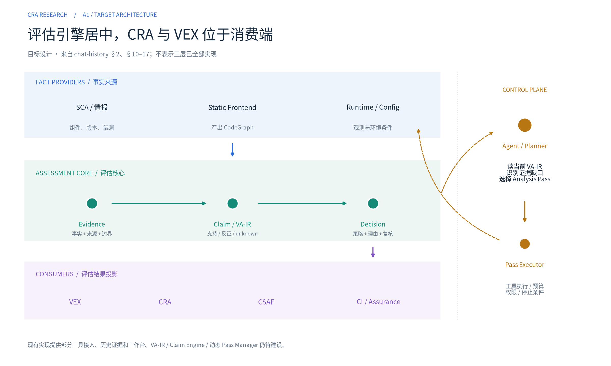

# Vulnerability Assessment Engine · CRA / SCA 研究

本项目研究一套**以证据驱动的漏洞评估引擎**：从 SCA 发现的组件与漏洞出发，定位到具体代码，收集可达性及运行上下文证据，形成可解释的判断，并在输入变化后重新评估。**CRA 是首个业务场景；VEX、CSAF、CI/CD 等是评估结果的消费端。**

仓库包含领域与法规研究、竞品分析、目标架构，以及可运行的证据工作台原型。当前阶段是**架构验证与 PoC**，完整评估引擎尚未实现。

[目标架构与差距](docs/design/assessment-engine-alignment.md) · [图解阅读版](demo/cra_workbench.md) · [已有实现](docs/design/unified-workbench.md) · [专题研究](docs/README.md) · [本地运行](docs/development.md)

## 核心问题

对某个产品发布物、组件、漏洞和运行上下文，我们需要连续回答：

- 漏洞影响哪个版本，具体对应哪段代码？
- 应用能否到达该代码，利用前提是否成立？
- 哪些证据支持或反驳这个判断，还有哪些未知项？
- 下一步应运行什么分析，什么时候需要停止或人工复核？
- 修复经过什么验证？源码、情报或配置变化后，哪些判断需要重算？

核心链路是：

```text
SCA / 漏洞关联 → Assessment Target
                       ↓
              Localization（定位到代码）
                       ↓
            Reachability / Exploitability
                       ↓
              Evidence → Claim → Decision
                       ↓
            VEX / CRA / CSAF / CI 等消费端

控制侧：证据缺口 → Agent / Pass Manager → 工具执行 → 新证据
反馈环：修复与验证 / 持续监控 → 输入变化 → Claim 失效 → 重新评估
```

## 目标架构



*目标设计图，不表示各层已经实现。*

| 层次 | 职责 |
|---|---|
| Fact Providers | SCA、静态分析、Runtime、情报等提供带来源和适用范围的证据；CodeGraph 是程序事实表示 |
| Assessment Core | 用 VA-IR（漏洞评估中间表示）组织 Evidence、Claim、Decision 与依赖；保留反证、未知项及历史 |
| Agent / Pass Manager | 根据当前证据缺口选择分析能力；执行器约束前置条件、权限、预算和停止行为 |
| Consumers | 将明确的决策修订投影为 VEX、CRA 工作流、CSAF、CI 门禁等 |

**Localization 连接供应链与代码分析；结构可达不等于可利用。** `unknown`、`needs_review`、`stale` 分别表达分析不确定性、复核流程和有效性，不能混成一个状态。

设计来源见 [架构讨论记录](docs/chat-history.md)，与现有代码的逐项对照见 [架构对齐评估](docs/design/assessment-engine-alignment.md)。

## 推荐阅读顺序

| 顺序 | 内容 | 阅读目的 |
|---|---|---|
| 1 | [架构对齐评估](docs/design/assessment-engine-alignment.md) | 理解目标、现有差距和下一轮验证重点 |
| 2 | [图解阅读版](demo/cra_workbench.md) | 跟随 C 样例看 Localization、Claim、Pass 推演和失效传播 |
| 3 | [已有工作台实现](docs/design/unified-workbench.md) | 明确当前代码真正具备的能力与限制 |
| 4 | [研究总报告](docs/research/00-final-report.md)，先读 §1、§5、§6 | 回看 CRA 业务入口、产品动机与研究依据 |

图解阅读版从 Notebook 的已保存输出自动生成，包含全部九张图和文字结果，通过普通 Markdown 页面阅读，避免依赖 Notebook 预览服务。[可执行 Notebook](demo/cra_workbench.ipynb) 仍保留供下载和本地运行。**历史实测回放、只读设计投影、预设脚本推演**分别标注；预设的 Pass 步骤不代表 Agent 已运行。Go 调用网络、修复结果与 CRA 时钟保留在附录。

## 专题研究

| 专题 | 内容 |
|---|---|
| [领域知识体系](docs/research/01-domain-ontology.md) | CVE、OSV、SBOM、VEX、CSAF 等概念及其关系 |
| [CRA 法规研究](docs/research/02-cra-regulation.md) | 法规义务与产品能力映射 |
| [竞争格局](docs/research/03-competitive-landscape.md) | 厂商能力、定位与差异化判断 |
| [技术深挖](docs/research/04-technology-deep-dive.md) | 可达性、可利用性、证据图与 Agent |
| [欧盟合规全景](docs/research/05-eu-compliance-landscape.md) | CRA 与相关合规体系的关系 |
| [产品形态与技术栈](docs/research/06-product-forms-and-tech-stacks.md) | 部署方式、开源复用与自研边界 |
| [厂商深挖](docs/research/07-vendor-deep-dive/README.md) | Snyk、Endor、Black Duck、Sonatype、JFrog 的专题分析 |

按角色阅读、来源追溯及历史材料说明见 [完整阅读指南](docs/README.md)。

## 当前进展

| 类别 | 已有内容 | 边界 |
|---|---|---|
| 原始 PoC | Go/C 扫描与分析样例、人工漏洞定位映射、签名证据 | 小样例验证；C 定位依赖策展 |
| 可运行原型 | 证据包导入、发布物身份、复核记录、历史、显式重估、修复复核、事件台账与内部导出 | 单实例本地工作台；重估尚不自动重跑分析 |
| Notebook 教学 | 三层架构、VA-IR/Claim 投影、Pass 选择与失效传播示例 | 只读投影与脚本推演，不是生产评估核心 |
| 尚未实现 | 独立 Claim/Decision Engine、动态 Agent 调度、持续失效重算、完整 Consumer 适配 | 不能将图解或保存输出视为实现完成 |

统一回放包含 **2 个发布物、78 条判定候选、154 条历史签名记录**，导入与导出重新验签；当前有 **21 项测试**。这些数字描述样例与工程校验范围，不代表生产分析精度。当前输出为内部复核包，新判定尚未正式签发为标准 VEX。

## 下一轮优先验证

1. **Localization**：将现有 CVE→文件/符号映射提取为独立能力，绑定来源与程序基线。
2. **Claim / VA-IR**：表达支持证据、反证、未知项、适用范围和依赖。
3. **证据缺口调度**：定义 Pass 契约，先建立可回放基线，再验证 Agent 的动态选择。
4. **Decision / Adapter**：以策略消费 Claim；替换 VEX、CRA 或 CI 消费端无需改写分析核心。
5. **失效与重估**：输入变化沿依赖传播，重算相关结果并保留历史修订。

具体切片与验收见 [架构对齐评估 §5](docs/design/assessment-engine-alignment.md)。认证、数据库部署和正式签发仍是后续交付工作；当前优先验证上述核心假设。

## 仓库结构

| 目录 | 用途 |
|---|---|
| [docs/research/](docs/research/) | 研究报告与来源资料 |
| [docs/product/](docs/product/) | 用户流程 |
| [docs/design/](docs/design/) | 实施设计与决策依据 |
| [src/cra/](src/cra/) | 共享核心、CLI 与展示生成 |
| [demo/](demo/README.md) | 团队演示与生成脚本 |
| [poc/](poc/README.md) | 原始扫描管道、样例与签名证据 |
| [tests/](tests/) | 核心行为验证 |
| [docs/archive/](docs/archive/cra-research-2/README.md) | 第二份研究的历史归档 |

需要运行或修改代码，请看 [开发与运行指南](docs/development.md)。两份研究的合并依据见 [综合评估](docs/design/repository-unification-assessment.md)；目标方向见架构对齐评估，当前代码能力以工作台实施文档为准。
