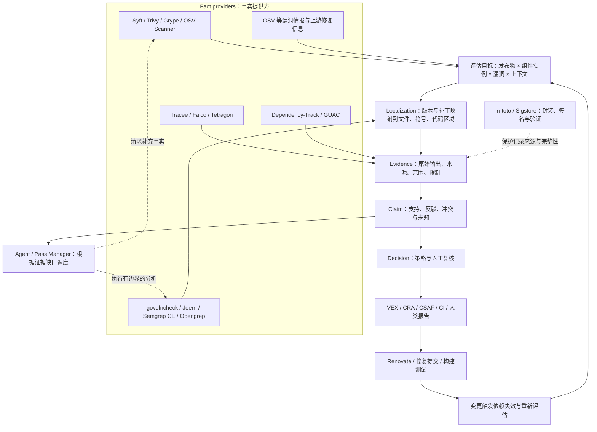

# 08 — 开源生态：漏洞评估引擎的复用边界与接入路线

> 来源核验：2026-09-23。面向本仓库的工程选型，不是完整市场普查。官方能力描述不等于本仓库实测；下文分别标出**事实、工程判断与待验证项**。许可证记录针对链接所指项目或规范，未覆盖其全部依赖、规则包、商业服务及分发方式，也不据此作授权结论。

本仓库可以复用组件发现、漏洞情报、程序分析、签名和依赖更新工具；需要重点建设的是把这些输出组织成**有上下文、有适用范围、可解释、可失效重估的评估结果**。工具数量不是完整性的指标：一个漏洞命中还需要经过代码定位、证据解释、策略判断，才可以形成面向 VEX、CRA 或 CI 的结论。

本文承接[评估引擎方向与差距](../design/assessment-engine-alignment.md)。当前仓库已经保存 C/Go 的历史 PoC 证据，并能在工作台验签回放；完整 VA-IR、Claim Engine 和动态 Pass Manager 仍是目标设计。

## 1. 先把生态放到正确的位置

图中箭头是**建议的集成关系**，不是已实现的调用链。Dependency-Track 可以同时消费评估结果；GUAC 可以提供跨制品关系查询。它们与评估核心之间需要适配，不宜仅因都有“图”或“漏洞状态”就合并对象模型。

还需要区分四类对象：

| 类型 | 示例 | 本仓库如何使用 |
|---|---|---|
| 可运行的开源项目 | Syft、Joern、GUAC、Renovate | 固定版本运行，保存输入输出与工具来源 |
| 情报与数据服务 | OSV 数据库/API | 保存查询和响应版本，保留别名、匹配条件及覆盖缺口 |
| 交换格式与规范 | CycloneDX、SPDX、OpenVEX、in-toto Statement、SLSA | 定义交换或证明结构；不会自行完成漏洞评估 |
| 具有独立商业条款的能力 | CodeQL CLI、Semgrep 商业分析、托管服务 | 与其开放源码部分分开核验，不能统一标成“开源引擎” |

OSV-Scanner 是 OSV 数据的工具入口，OSV API 是数据服务，两者不是同一个接入。CodeQL 的查询和库开放源码，不意味着 CLI 引擎也开放源码；私有代码使用应核对对应产品授权。[OSV 官方说明](https://google.github.io/osv.dev/)、[OSV-Scanner](https://github.com/google/osv-scanner)、[CodeQL CLI 官方说明](https://docs.github.com/en/code-security/concepts/code-scanning/codeql/codeql-cli)。

## 2. 分层选型：工具能交付什么

以下“接入成本”是针对本仓库小规模原型的**定性工程判断**，不是供应商承诺或测量工时：低表示主要是 CLI/JSON 适配；中表示还要维护身份映射、构建环境或服务；高表示需要程序语义、内核部署或多源关系建模。成本不代表分析精度。

### 2.1 组件发现与漏洞候选

| 项目 | 输入 → 输出（官方能力） | 评估边界与本仓库用途（判断） | 成本 |
|---|---|---|---|
| [Syft](https://github.com/anchore/syft) | 镜像、文件系统等 → 软件清单，支持 CycloneDX/SPDX 等 | 作为组件事实入口；清单识别不等于函数定位。已知漏识别保留独立增补来源 | 低；C vendoring 中 |
| [Trivy](https://github.com/aquasecurity/trivy) | 镜像、仓库、文件系统等 → 漏洞、配置问题、敏感信息与 SBOM 等结果 | 适合已有容器/CI 流程的统一入口；只接入当前需要的结果类型，不把扫描告警直接升级成 Claim | 低至中 |
| [Grype](https://github.com/anchore/grype) | 镜像、文件系统或 SBOM → 已知漏洞匹配；可消费 OpenVEX | 适合对固定 SBOM 作第二来源比对；与其他扫描器的差异要追溯到组件和数据库，不能投票决定影响状态 | 低 |
| [OSV-Scanner](https://github.com/google/osv-scanner) | 源码依赖、受支持清单或镜像 → 组件与漏洞结果；部分场景有 call analysis | 可替代部分自写关联逻辑，也值得验证 vendored C/C++ 识别；语言、版本及分析模式必须单独验收 | 低；call analysis 中 |

OSV-Scanner 的 V2 使用文档把“提取组件”和“漏洞匹配”分开；call analysis 是额外能力，不能由“支持某语言的包扫描”推导“该语言都支持函数级分析”。本轮不维护一份可能迅速过时的全语言能力表，落地时应针对固定版本和样本确认。[V2 使用说明](https://google.github.io/osv-scanner/usage/)、[输出与 call analysis](https://github.com/google/osv-scanner/blob/main/docs/output.md)。

### 2.2 Localization 与程序事实

| 项目 | 输入 → 输出（官方能力） | 评估边界与本仓库用途（判断） | 成本 |
|---|---|---|---|
| [govulncheck](https://pkg.go.dev/golang.org/x/vuln/cmd/govulncheck) | Go 源码或二进制、Go 漏洞数据库 → 漏洞发现和相应分析结果 | Go 优先入口；源分析和二进制分析能力有差异。保存运行模式、构建环境及 trace，不把结果外推到其他语言 | 低至中 |
| [Joern](https://github.com/joernio/joern) | 受支持源码/字节码/二进制 → CPG 与查询结果 | 给 Localization、调用路径和数据流 Pass 提供程序表示；CVE 到目标符号仍需独立来源。本仓库 BFS 不等于完整数据流或可利用性分析 | 高 |
| [Semgrep CE](https://docs.semgrep.dev/semgrep-ce-languages) | 源码与规则 → 匹配、位置及受支持的分析结果 | 适合代码区域定位和局部条件检查。官方将 CE 与商业跨文件分析区分，不能把后者算入 CE | 低；规则维护中 |
| [Opengrep](https://github.com/opengrep/opengrep) | 源码与兼容规则 → JSON/SARIF 等分析结果 | 可作为规则分析候选；官方声明规则兼容，仍需用本仓库规则和失败样本验证语义、输出及迁移差异 | 低至中 |

**工程判断：Localization 应独立建模。** 扫描器给出 `组件 + 版本 + CVE`，程序工具给出 `文件 + 符号 + 路径`，两者之间需要保存补丁、advisory、构建清单或人工策展的映射依据。规则命中只能支持它实际检查的条件；CPG 中有调用路径，也不能直接证明输入可控、触发条件满足或漏洞已被利用。

当前 C 示例正好暴露这个接缝：[策展映射](../../poc/curation/vuln-function-map.json) 指向 zlib 漏洞函数，[reach_c.py](../../poc/pipeline/reach_c.py) 再查询 Joern 图。下一步应输出独立 `LocalizationResult`，保留定位粒度、基线、候选集合与未解决项，而不是将这一步藏在 reachability 脚本里。

### 2.3 资产关系、证据封装与结果交换

| 项目/规范 | 输入 → 输出（官方能力） | 评估边界与本仓库用途（判断） | 成本 |
|---|---|---|---|
| [Dependency-Track](https://github.com/DependencyTrack/dependency-track) | SBOM 与漏洞信息 → 组件风险管理平台 | 适合作为团队资产入口或结果消费端；保留外部项目/组件身份，避免把其审计状态直接复制成核心 Claim | 中 |
| [GUAC](https://github.com/guacsec/guac) | 软件安全元数据 → 可查询的关系图 | 适合跨制品影响面查询；供应链关系不自动具有程序调用或 Claim 推导语义 | 中至高 |
| [in-toto Statement](https://github.com/in-toto/attestation/blob/main/spec/v1/statement.md) 与 [Python 实现](https://github.com/in-toto/in-toto) | subject digest、predicate 等 → 有明确类型的证明记录；实现提供相关封装/验证能力 | 复用记录封装，自定义 predicate 仍需定义字段和证据语义；签名有效不代表判断正确 | 低；信任策略中 |
| [Sigstore / Cosign](https://github.com/sigstore/cosign) | 制品或记录、签名身份/密钥 → 签名与验证结果 | 可用于替换开发密钥方案的部分环节；身份、验证策略及存储模式需另行设计，不与 in-toto 格式混为一谈 | 中 |
| [OpenVEX](https://github.com/openvex/spec/blob/main/OPENVEX-SPEC.md) | 产品、漏洞、状态与说明 → 可交换的 VEX 文档 | 作为 Decision 的输出格式；其影响状态无法承载全部分析过程、证据冲突、审批与失效维度 | 低；语义映射中 |

**工程判断：Evidence、Claim、Decision 要分开。** Evidence 记录观察及来源；Claim 表达在什么范围内得到何种支持或反驳；Decision 使用策略和复核形成对外结果。平台、图数据库、签名格式分别解决其中一些问题，接入任一个都不能单独证明完整评估核心已经建成。

### 2.4 运行事实与修复回路

| 项目 | 输入 → 输出（官方能力） | 评估边界与本仓库用途（判断） | 成本 |
|---|---|---|---|
| [Tracee](https://github.com/aquasecurity/tracee) | Linux/eBPF 运行事件 → 观测与安全检测信息 | 作为场景内运行证据；必须绑定制品、环境、采集策略与时间窗口 | 中至高 |
| [Falco](https://github.com/falcosecurity/falco) | 系统事件及规则 → 运行时安全告警 | 适合补充行为事实；告警需关联具体评估目标，不能天然视为某 CVE 的利用证明 | 中至高 |
| [Tetragon](https://github.com/cilium/tetragon) | eBPF 观测/策略 → 进程、系统调用、I/O 等事件及运行控制 | 可验证部署上下文与相关活动；第一轮优先只接观测，控制动作另行设计 | 中至高 |
| [Renovate](https://github.com/renovatebot/renovate) | 依赖清单及更新策略 → 依赖更新变更/PR | 作为修复动作入口；升级后重新构建和评估，不能用 PR 合并事件替代修复证据 | 中 |

**工程判断：没有观测到，不等于不存在。** 运行时负面结论要带工作负载、采样、覆盖面与时间窗口；未执行的路径保持未知。依赖升级也只说明输入改变，仍需验证目标漏洞、回归测试与最终制品。

## 3. 许可证与产品边界

这里只记录核验页面展示的项目级许可证。实际集成应固定 tag/commit，并检查所使用文件、规则、依赖和制品的声明；下面没有给出“可随意商业集成”等结论。

| 核验对象 | 项目级声明 | 官方依据 |
|---|---|---|
| Syft / Grype | Apache-2.0 | [Syft](https://github.com/anchore/syft)、[Grype](https://github.com/anchore/grype) |
| Trivy / OSV-Scanner | Apache-2.0 | [Trivy](https://github.com/aquasecurity/trivy)、[OSV-Scanner](https://github.com/google/osv-scanner) |
| govulncheck（golang.org/x/vuln） | BSD-3-Clause | [Go 包文档](https://pkg.go.dev/golang.org/x/vuln/cmd/govulncheck) |
| Joern | Apache-2.0 | [Joern 仓库](https://github.com/joernio/joern) |
| Semgrep 开源引擎 / Opengrep | LGPL-2.1 | [Semgrep CE 说明](https://docs.semgrep.dev/semgrep-ce-languages)、[Opengrep](https://github.com/opengrep/opengrep) |
| Dependency-Track / GUAC | Apache-2.0 | [Dependency-Track](https://github.com/DependencyTrack/dependency-track)、[GUAC](https://github.com/guacsec/guac) |
| in-toto Python 实现 / Cosign | Apache-2.0 | [in-toto LICENSE](https://github.com/in-toto/in-toto/blob/develop/LICENSE)、[Cosign](https://github.com/sigstore/cosign) |
| OpenVEX **规范仓库** | CC0-1.0 | [openvex/spec](https://github.com/openvex/spec)；不据此推断所有实现许可 |
| Tracee / Falco / Tetragon | 根仓库声明 Apache-2.0 | [Tracee](https://github.com/aquasecurity/tracee)、[Falco](https://github.com/falcosecurity/falco)、[Tetragon LICENSE](https://github.com/cilium/tetragon/blob/main/LICENSE)；内核程序、依赖等具体文件仍需核对 |
| Renovate CLI | AGPL-3.0 | [Renovate license](https://github.com/renovatebot/renovate/blob/main/license) |

Semgrep 的引擎许可不自动覆盖所有规则包和商业分析；CodeQL 查询/库与 CLI 的许可也必须分开记录。托管服务是否免费、是否允许私仓、是否能离线运行，是另外几个维度，不能从源码许可证直接推导。[Semgrep 产品能力区分](https://docs.semgrep.dev/semgrep-ce-languages)、[CodeQL CLI](https://docs.github.com/en/code-security/concepts/code-scanning/codeql/codeql-cli)。

## 4. 本仓库到底验证到了哪一步

“已跑 PoC”指仓库有历史执行脚本和输出，不表示本次撰文重跑了外部工具；“回放”指读取已有证据进行验签、展示或状态处理；“候选”只有资料与接入设想。

| 对象 | 状态 | 可核验的仓库依据 | 不能据此宣称 |
|---|---|---|---|
| Syft → CycloneDX | 历史 PoC 已跑 | [sbom.py](../../poc/pipeline/sbom.py)、[C SBOM](../../poc/out/c-vuln-app/sbom.cdx.json) | 所有 vendored/静态链接组件都能自动识别；C 样例有人工增补 |
| OSV API 关联 | 历史 PoC 已跑 | [associate.py](../../poc/pipeline/associate.py)、[C 关联输出](../../poc/out/c-vuln-app/associations.json) | 已接入 OSV-Scanner；C 的 PURL 查询已完整覆盖 |
| govulncheck | 历史 PoC 已跑 | [reach_go.py](../../poc/pipeline/reach_go.py)、[原始 JSON](../../poc/out/go-vuln-app/govulncheck.json) | 所有 OSV 候选都被其数据库或分析覆盖 |
| Joern + 策展 + BFS | 历史 PoC 已跑 | [reach_c.py](../../poc/pipeline/reach_c.py)、[CPG 导出](../../poc/out/c-vuln-app/joern-cpg-dump.tsv) | 已验证复杂间接调用、输入可控性或可利用性 |
| in-toto / DSSE / Ed25519 | 历史 PoC 已跑 | [attest.py](../../poc/pipeline/attest.py)、[证据包](../../poc/out/evidence-pack-c-vuln-app-0.1.0/) | 已接 Sigstore、生产身份体系或外部可信时间服务 |
| OpenVEX 生成与导入 | 历史 PoC + 当前回放 | [vex.py](../../poc/pipeline/vex.py)、[Store](../../src/cra/core.py) | 历史工具状态等同于已批准的当前 Decision |
| 工作台、图解与 Notebook | 证据回放；部分设计演示 | [图解阅读版](../../demo/cra_workbench.md)、[演示投影](../../demo/assessment_walkthrough.py) | Notebook 重新执行扫描；演示 Planner 已具备动态调度 |
| Trivy、Grype、OSV-Scanner、Semgrep CE、Opengrep | 集成候选 | 本文及[技术栈研究](06-product-forms-and-tech-stacks.md) | 已有适配器、准确率或性能对比 |
| Dependency-Track、GUAC、Sigstore、Tracee、Falco、Tetragon、Renovate | 集成候选 | 本文给出的官方来源 | 已部署、已打通双向同步或生产可用 |

历史结果的日期、数字和局限见 [PoC README](../../poc/README.md)。其中 C 样例依赖人工映射、Go 情报源存在覆盖差，是后续设计的输入条件；不应为了展示工具链完整而隐藏。

## 5. 复用、自研与 Agent 的责任

以下是结合现有资产的**工程建议**，不是对整个行业能力的排他性判断。

| 优先复用 | 本仓库需要定义与实现 | 原因 |
|---|---|---|
| 包识别、清单解析、漏洞数据库客户端 | 组件实例与发布物身份、别名归并、来源冲突 | 同一包名不等于同一制品中的同一实例 |
| 语言前端、CPG、调用/数据流查询、规则引擎 | Localization 契约、分析范围和失败语义 | 工具局部结果需要绑定评估目标和假设 |
| 签名封装、验证库、内容寻址基础设施 | Evidence/Claim/Decision 模型、依赖关系、信任策略 | 完整性、语义支持和业务批准是不同问题 |
| 通用任务执行器或工作流设施 | Pass 契约、证据缺口调度、预算和停止条件 | 固定流水线不能表达全部条件分析，但无须为此重造所有执行基础设施 |
| VEX 等交换规范、团队平台接口 | 状态映射、审批、失效与消费端策略 | 不能丢掉未知、冲突、适用范围及过期信息 |
| 更新机器人、构建与测试系统 | 修复前后证据关联及针对性重估 | 输入变化不会自动证明目标问题已解决 |

Agent 在这里扮演动态 Pass Manager：读取当前证据缺口，选择已登记的 Pass，提交受约束的输入，等待结构化结果，再决定继续分析或交给人工。它可以提出定位候选和分析计划；候选必须留下来源与验证状态。模型文本不直接替代工具证据或签发对外结论。

本轮未做通用 Agent 框架的完整比较。先明确 `PassSpec → PassRun → EvidenceDelta`、可用输入、超时/失败/不支持、缓存键和预算，比先选某个 Agent SDK 更有助于验证当前架构。

## 6. 下一轮只做一个可验收的小切片

建议先沿用现有 C/zlib 样例，增加一个反例和一个失效场景，验证“映射 → 分析 → Claim → 重估”，而不是同时部署表中所有工具。

| 步骤 | 产物 | 验收标准 |
|---|---|---|
| 固定基线 | 源码/制品摘要、工具版本或镜像 digest、规则与情报快照 | 同一证据能够追溯到唯一输入；现有 Joern `nightly` 改为实验记录中的固定版本 |
| 抽取 Localization | 组件实例、漏洞、文件/符号/区域、映射来源、未知项 | 手工映射明确标注；映射不到时仍生成 `unknown`，不跳过目标 |
| 封装一个 Joern Pass | 输入输出契约与原始输出引用 | 成功、工具失败、超时、无路径分别记录；无路径不能自动转为 `not_affected` |
| 形成两类 Claim | 代码定位与结构可达性 Claim | 每条引用证据、范围、假设；可利用性尚未检查时仍为未知 |
| 做反例与变更实验 | 未解析调用样例、源码修改后的依赖失效记录 | 保留不完整分析；只将依赖已变输入的 Claim 标 stale，不覆盖旧证据 |
| 导出消费结果 | VEX/阅读报告的适配输出 | 未经策略/复核的不足证据不会伪装成确定结论；可从输出回查依据 |

随后再做两个有边界的生态比较：用固定 SBOM 比较 Grype 与当前 OSV 关联，归因每个差异；用同一 vendored C 样例试验 OSV-Scanner，评估是否减少人工识别工作。这里验证的是**特定样例和版本的适用性**，不是宣布工具全面胜出。

## 7. 尚未确认的事项

- 本轮核验官方能力与项目级许可，没有新跑这些候选工具的准确率、耗时或资源基准，也没有确认真实业务仓库覆盖率。
- 未固定所有候选工具的最终集成版本；`main`/在线文档会变化，实验应记录实际版本、配置、情报快照与输出格式。
- Joern 的复杂调用解析、规则引擎对本业务漏洞的表达能力、运行观测的代表性，都需要包含失败案例的数据集。
- Dependency-Track/GUAC 的身份映射、双向状态同步、部署容量和迁移成本仍需小规模试接，不能由项目介绍估出。
- 最终许可证核验应落到实际使用的源文件、规则包、依赖与分发形态；当前表格只是选型记录入口。

继续阅读：[评估引擎设计对齐](../design/assessment-engine-alignment.md) · [技术深挖](04-technology-deep-dive.md) · [产品形态与技术栈](06-product-forms-and-tech-stacks.md) · [历史 PoC](../../poc/README.md)。
